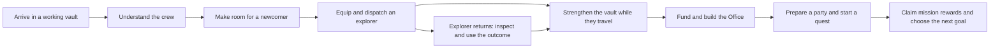

# New-player journey: from shelter to first mission

Status: direction approved for #1034 on 2026-11-15. Opening implementation is the
first delivery slice; recruitment, economy and Office changes follow separately. Baseline:
`98c19d47` (2026-11-15). This defines the redesigned player experience. The approved recruitment bridge
still needs its exact reward placement, budget and cohort migration before
implementation. Existing server rules apply until their changes ship.

## Player promise

“You have inherited a working shelter. Make room for people, prepare someone for
the wasteland, and grow a community capable of running its first mission.”

Start with a functioning small vault rather than an empty construction exercise.
The player learns by making a useful decision and seeing its consequence. The
short introduction ends when the first explorer leaves. A visible, optional vault
guide carries the longer journey through the Office and first quest.

## The line

The return is a parallel thread, not a prerequisite for building the Office.
Ordinary production runs automatically. Decisions about staffing, spending,
loadouts, dispatch and claims stay with the player.

## Starting position

Keep the current standard start as the design baseline: nine residents, staffed
power/food/water rooms, living space, storage, equipment and 1,000 caps. Explain
that the player is taking charge of an existing community. Existing staffing may
already satisfy a milestone; never ask the player to undo a good assignment.

Account creation leads to vault creation. Name/number are the essential choices;
theme, audio and optional settings can be skipped and changed later. Introduce
only the vault, crew and guide initially; reveal other destinations when useful,
without locking experienced players out of existing navigation.

## Milestones and rewards

Rewards below describe their purpose first. Existing named residents and useful
starter items should carry forward where possible. Exact revised rewards need a
complete budget before implementation; viewing a lesson alone earns nothing.

| Milestone | What the player actually does | Reward / visible outcome | What it enables |
| --- | --- | --- | --- |
| 1. Take command | Read the resource trend, open the generator and inspect a worker's SPECIAL match. Keep an already-good assignment. | Claim the existing 50-cap staffing reward if earned. Show the crew's contribution; no extra reward for clicking Continue. | Understand how people keep the vault running. |
| 2. Make room for one more | Choose a legal location and build additional Living Quarters. See price and capacity before confirming. | Claim Juno Pike, then see the actual newcomer and their available roles. | A real person to inspect, equip or assign; a reason to care about capacity. |
| 3. Prepare the explorer | Choose a healthy available adult, compare a weapon, then equip an outfit. Explain each tradeoff. | Reuse the weapon lesson's Wasteland gear reward and the outfit lesson's resident reward. These lessons move before departure in the proposed guide/catalog order. | A deliberate first loadout and workforce replacement. |
| 4. First departure | Choose duration and supplies, inspect the production impact, then explicitly Send. Offer touch/keyboard controls alongside drag-and-drop. | Claim the existing departure resident, Elias Reed. Show the explorer, status and expected return. | The first parallel activity. Finish the short introduction here. |
| 5. Keep the community supplied | Produce the starter power/food/water targets through normal work. Assign incoming residents where they help; allow simultaneous progress. | Existing production residents, claimed separately when earned. Show the resulting output and consumption. | Growth with a useful staffing decision attached to each arrival. |
| 6. Expand with a purpose | Add generator space, staff it, and develop a worker/explorer to level 2. Plan housing and caps ahead. | Existing expansion resident, cap rewards and Hunting rifle. Proposed additional earned recruitment closes the 16-to-18 gap; see the decision below. | A sustainable larger crew, another usable weapon and an affordable Office path. |
| 7. Open the Office | Inspect the population/build requirements, reserve its cost, choose placement and build. | Quests become available. Retain a useful equipment reward; do not immediately instruct the player to destroy their new rare weapon. | A specific eligible mission and a preview of party requirements. |
| 8. First party, first mission | Choose an available mission, compare its actual requirements, select eligible crew and equipment, and explicitly Start. Explain who stays home to produce. | Mission departs; the guide becomes optional follow-up. The eventual claim pays the mission's actual authored rewards. | A second repeatable loop with larger stakes and explicit preparation. |
| 9. Make the outcome useful | On return, inspect what happened, claim where required, and choose one concrete use for what arrived. | Real loot/caps/XP and visible progression. Suggested next action depends on current inventory, crew and capacity. | Equip an upgrade, recover a dweller, expand, or prepare the next mission. |

The first solo return can interrupt chapters 5–8 naturally. Its rewards must say
what was already granted, what needs a claim and what remains held as overflow.
Never make dismissing a report look like collecting rewards. A historical item
may already be equipped or sold; suggestions must use current state.

## Rhythm and pacing

These are prototype targets, not measured completion times or promises:

- **Opening, roughly 5–10 active minutes:** staffing inspection → construction →
  newcomer → equipment → dispatch. One current action, a visible consequence and
  one next destination. Every explanation is skippable.
- **After departure, roughly 10–30 more active minutes:** run the vault, claim
  earned production milestones, expand and prepare the Office. Several objectives
  can progress together; the UI does not turn them into a forced linear click tour.
- **First quest departure:** aim to make it reachable within the first substantial
  session, without waiting for breeding or an explorer's return. This is a proposed
  pacing change, dependent on the recruitment/economy decision below.
- **A natural return session:** review expedition/mission outcomes, make one useful
  improvement and choose the next deployment. Current solo roam requests have a
  minimum duration of one hour; include the actual return leg in displayed timing.
  This plan does not shorten travel or invent an instant tutorial expedition.
- **Later sessions:** introduce care when someone needs it, training when its room
  and next role are relevant, and crafting when a real recipe/material opportunity
  exists. Family growth, recruitment and specialization become chosen directions.

Never leave “wait” as the only instruction. Explain what is underway, when a return
is expected, what useful work remains, and when it is reasonable to leave the game.
Do not promise that an unattended vault is safe until its offline behavior and
resource budget have been playtested.

## Dynamics: why the next step feels worthwhile

- **People are useful rewards.** An arrival has an identity, a visible place in the
  roster and an understandable job. More residents also consume supplies; growth
  must remain supportable rather than triggering an unexplained shortage spiral.
- **Rewards fund the next decision.** Housing enables arrivals; gear enables safer
  deployment; recruits sustain production; earned caps fund the Office. Avoid a
  cash grant that silently has to be saved for an unexplained future gate.
- **Preparation comes before risk.** Teach equipment before first dispatch. Show
  the cost of taking someone away from production, and let the player cancel.
- **Achievements recognize real play.** Already-satisfied milestones count, later
  starter objectives accumulate progress, and players may claim earned rewards.
  Acknowledging guidance never fabricates a completed action or a reward claim.
- **The world continues on two tracks.** Work in the vault while expeditions run;
  use their outcomes to improve the next deployment. Timers support the rhythm
  rather than serving as compulsory reading screens.
- **The player gains independence.** Specific help becomes lighter as a mechanic
  becomes familiar. There is no mandatory tour through every feature, forced
  equipment choice, automatic spending or automatic reward claiming.

## Main product decision: getting to the Office

**Recommendation: family growth should be optional, and the first quest should
not require a three-hour pregnancy wait.** Keep the Office at population 18 and
1,000 caps initially; design two additional earned starter recruits to bridge
16 → 18 through existing production/expansion milestones. Do not require an
exploration return for those grants. Check housing and resource demand before
settling their exact milestone placement and identities.

This is a new reward/pacing proposal, not a description of the current game. The
current track grants seven residents, taking nine to sixteen, then teaches two
births to reach eighteen. Pregnancy takes three hours after conception. Children
count toward population but are not immediately adult quest crew. Two extra adult
recruits change workforce capacity as well as pacing, so their production effects
must be measured. Existing vaults must retain their earned rewards and cohort.

If retaining the current family gate is preferred, the honest alternative is a
multi-session Office journey with an explicit family chapter and useful interim
work. It cannot be advertised as a first-session quest path. Do not combine an
unchanged gate with an unsupported shorter timeline.

## Reward and economy checks before locking numbers

Source inspection found a documentation discrepancy: the current starter JSON
sums to **900 pre-Office caps**, while GAME_MECHANICS.md describes **1,100**. The
seven pre-Office resident rewards agree. Resolve this against a fresh, ordinary
player's claim history before tuning or presenting a final reward schedule.

With 1,000 starting caps, the catalog's nominal pool is 1,900 before the Office.
The Office costs 1,000. A real budget must include housing, incremental generator
costs, any required care building, staffing downtime, consumption and room power
load. Separate mandatory purchases from tempting optional spending. Explain the
Office savings goal early, and provide a recoverable path if the player spends
elsewhere; finite starter payouts alone do not establish that recovery exists.

No plan relies on random loot, a lunchbox purchase, passive cap income, selling
irreplaceable starter equipment or destroying the first useful rare reward. Later
scrapping teaches a deliberate decision using an expendable item. Exact reward
changes, recovery funding, any gate changes and migration design remain for review.

## What the guide should show

One current milestone, the reason it matters, its reward and a direct action.
Keep the next chapter and the Office savings/population goal visible without a
full-screen list of chores. Show claim-ready work clearly and celebrate claims
with the existing modal/toast plus bell behavior where applicable.

Use existing screens for the action. Short contextual help appears there, yields
to dialogs, and recognizes prerequisites and already-completed work. Preserve
skip/resume/replay, per-vault progress, reload and vault switching. Replay teaches
without regranting rewards. Phone, keyboard and reduced-motion users get the same
functional journey.

## Delivery after the plan is agreed

1. Storyboard the opening and Office path at desktop and phone widths, including
   the newcomer, loadout, first departure and one return. Review the proposed
   recruitment bridge and the cap/recovery budget before backend changes.
2. Prototype the new guide presentation with current screens and server state.
   Replace the old presentation when ready; keep one teaching-state owner and one
   reward authority. Do not ship two competing tutorial engines.
3. Implement the opening in small slices: inspect/staff → build/welcome → equip/send.
   Reuse existing operations and add regressions for reproduced failures.
4. Implement the approved growth/reward changes and migration/cohort protection,
   then connect Office → actual mission requirements → eligible party → Start.
5. Run authenticated ordinary-user desktop/phone playthroughs on fresh standard
   vaults. Record actual active time, real waiting, spending, production, claims,
   crew availability and confusion. Separately test interrupted/reloaded sessions,
   already-satisfied milestones, full housing/storage, failures and vault switches.

Success means a player can explain why they did each action, understand what they
received, identify what to do next, and leave and return without losing the thread.
There is no runtime verification claim in this planning document.

## Source baseline

- `backend/app/data/objectives/starter.json`: current milestone order and rewards.
- `backend/app/models/vault.py`: 1,000-cap default.
- `backend/app/services/vault/seeding.py`: standard rooms, crew and equipment.
- `backend/app/data/vault/rooms.json`: Office population 18, cost 1,000.
- `backend/app/schemas/exploration.py`: roam duration in hours, minimum one.
- `docs/backend/GAME_MECHANICS.md`: game rules, progression visibility and cohort constraints.
- `docs/frontend/ONBOARDING.md`: current presentation and dated runtime evidence.
- `docs/features/INTEGRATION_PLAN.md` and #1034: existing journey scope and evidence requirements.
