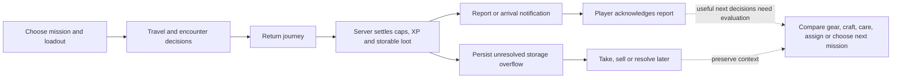

# Game-flow continuity and actionable rewards — research

Status: initial repository research, 2026-10-10. Product investigation only; no route removal, settlement change, automation policy, UI design or implementation is approved by this report.

Subsequent maintainer direction: objective rewards should require an explicit player claim, and objectives should provide a curated tutorial-like progression from early to later game. These requirements guide the objectives workstream; broader continuity and reward-handoff design still needs research. This report preserves its original source snapshot: references to pending youth/map PRs and observed settlement behavior describe that baseline, not current production or PR status.

Research tracker: [#928](https://github.com/ElderEvil/falloutProject/issues/928), containing the report and pinned source links.

Source baseline: local HEAD `e283bf7337ccc34d2c07efa46be1d95866eec994`. The sources below were inspected, including existing tests; authenticated runtime journeys, production data, balance and player comprehension were **not** tested. Findings distinguish source observations from design hypotheses. Recheck master before implementation because another agent is working concurrently.

## Product direction

The maintainer wants a strategy-focused vault simulation with coherent actions across screens. Frequent clicks to collect ordinary production are not the intended source of engagement. Rewards should make outcomes understandable and reveal useful opportunities, especially after exploration, without requiring the player to remember every subsystem or click every piece of loot.

The research question is: **after something changes, can the player understand what changed, make the important decision, and continue the relevant game loop without losing context?** Consistent appearance is helpful, but settlement semantics, navigation, persistence and consequences matter more than making every screen identical.

## Findings with source evidence

| Finding | Observed source behavior | Implication to investigate |
| --- | --- | --- |
| Ordinary production already runs automatically | `backend/app/services/resource_manager.py:process_vault_resources` calculates production minus consumption over elapsed time; `services/game_loop.py` has pause and capped catch-up behavior. The vault store updates balances/rates from tick events. | Preserve strategic staffing, capacity and resource-rate decisions; do not introduce repetitive collection just to resemble the original game. Offline pacing still needs playtesting. |
| Exploration settlement and report acknowledgment are different | `services/exploration/coordinator.py:finalize_return` restores dwellers, settles rewards and commits before publishing arrival. `exploration/rewards_service.py:apply_rewards` credits caps/XP and transfers loot. `ExplorationRewardsModal.vue` ends with “Collect Rewards,” whose handler only emits close. | The report reads like a claim even though most rewards are already granted. Distinguish granted, pending storage decisions and report acknowledgment. This does not justify changing settlement. |
| Overflow already has useful persistent decisions | `ExplorationRewardsModal.vue` has Take, Sell, Sell all remaining and Resolve Later. `ExplorationView.vue` fetches backend pending overflow on entry. | Retain deferability and backend recovery. Explore review/manage-storage/batch affordances before forcing another per-item loop. Selling is consequential, so convenience must retain player intent. |
| Quest claims are genuinely consequential | `progression/quests/service.py:mark_quest_ready_to_claim` and `claim_quest_rewards` separate party arrival from reward settlement; the claim persists granted rewards. `QuestsView.vue` supports `?claimQuest=...`. | Similar-looking exploration and quest completion surfaces represent different stages. Explain their differences before considering a common settlement policy. |
| Objective claim UI and backend semantics diverge | `progression/objectives/evaluators/base.py:_auto_complete` grants the reward and marks complete. `ObjectiveCard.vue` exposes Claim when progress reaches total but `is_completed` is false; the store posts `/complete`, whose endpoint requires `CurrentSuperuser`. | A dormant or stale-state claim branch is not an ordinary player claim contract. Validate a normal-user journey and settle vocabulary; do not relax admin authorization to imitate quests. |
| A report lists loot without continuing into its uses | `ExplorationRewardsModal.vue` shows item name, rarity, quantity and a check mark; stored-item rows have no compare/equip/craft/navigation action. `StorageView.vue` supports sale/scrap/lunchboxes; equipment services exist separately. | A reward can be visible yet fail to expose what it enables. Compare/equip, crafting, care and eligibility links are candidate handoffs, not requirements to add more loot. |
| Exact rewarded item identity needs investigation | `exploration/rewards_service.py:_transfer_loot_to_storage` builds/transfers rows but reports plain loot specs; `RewardsSchema.items` is `list[dict]`, without a stable typed item-ID contract. | Opening inventory is feasible with existing screens; equipping the exact rewarded copy directly may require a stronger receipt contract. Never resolve a mutable item by name alone. |
| Returned medicine is not explained in the modal | `RewardsSchema` includes remaining Stimpaks/RadAways, and settlement caps their storage return by medical capacity. The inspected rewards modal does not display those fields. | A debrief should separate found supplies, consumed supplies, returned supplies and the amount actually retained. Test full-capacity cases before trusting a nominal total. |
| Report recovery uses multiple channels | `usePendingReports.ts` stores reports in browser localStorage, deduplicated by exploration ID and filtered by vault. Exploration SSE adds reports; clicking a historical completion bell entry also queues its embedded summary. Overflow has a server query. | Same-device event recovery exists, but it is not a demonstrated cross-device/offline durable review contract. Trace notification retention, missed events, opt-outs, browser clearing and duplicate arrival before proposing a new archive. |
| Briefing emphasizes problems rather than opportunities | `OverseerBriefing.vue` covers incidents, resource warnings, unassigned dwellers, capacity and morale, displaying at most three attention items. It has no return/overflow/ready-quest/crafting/new-opportunity inputs. | The existing briefing is a reuse candidate for a strategy session entry point, but opportunity items must not crowd out critical warnings. Counts and destinations should come from current state, not unread notifications. |
| Some specific links already work | `notificationRouting.ts` routes ready quests to `?claimQuest`, training to the relevant dweller/stat, combat to `?roomId`, and locations to `?place`. Destination code consumes these queries. | Extend established handoffs rather than add another navigation system. Recheck stale/deleted entities and same-view activation. |
| Some events still lose context | Exploration notifications route to the list, relying on separate queuing to open a report. Recipe-unlocked and crafting-complete types have no explicit case in `notificationRouting.ts`, so they use the vault overview fallback. | Investigate contextual recipe/workshop/report destinations; notification “read” must not mean reward settled or decision resolved. |
| Training gains can produce a new staffing decision | `training_service.complete_training` applies the stat, ends the session, and releases the dweller to IDLE with no room. Training room cards are informational; empty training state describes building a room without linking to construction. | Stat gained → improved suitability/eligibility → reassignment is an incomplete strategic handoff. Any continue-training or return-to-work automation requires a separate policy decision. |
| Existing mechanical integration should be preserved | Reward settlement emits resource/item events; objective evaluators listen to those. `room_service.py` emits ROOM_BUILT/ROOM_UPGRADED; crafting lists unlock/material requirements and consumes junk. | Research should find broken or invisible integration, not assume these mechanics are disconnected. Some roadmap descriptions of missing construction events are historical. |

## Routes: classify before removing

Route existence, sidebar visibility, incoming links and useful behavior are separate questions. `hideFromNav` alone does not establish that a route is dead; the sidebar has its own explicit item list.

| Surface | Source classification | Research disposition |
| --- | --- | --- |
| Overview, Dwellers, Exploration, Objectives, Quests, Relationships, Training, Map, Storage, Trading | Registered and linked by `SidePanel.vue`; Trading is marked WIP. | Retain pending journey research. Assess labels and grouping by task rather than module. |
| Exploration detail | Registered, opened from ExplorerCard; links to dwellers and map already exist. | Useful contextual route. Verify completed-history/reward recovery, party handling and return to the original context. |
| Happiness | Registered, hidden from primary nav, linked from roster care summary; supports morale/radio/recovery actions. | Useful secondary operations screen, not dead. Evaluate care versus morale ownership; do not delete it for absence from sidebar. |
| Graveyard | Registered before the dynamic dweller route; reached from the dead-dwellers panel. | Useful historical/recovery boundary. Preserve distinction between reversible death and permanent loss. |
| Full-page `/dweller/:id/chat` | Registered and functional; source search found no ordinary navigation targeting it, while current dweller actions open a query-driven global chat modal. | Candidate compatibility/alternate surface. Check bookmarks, external links and use before deciding keep, redirect or retire. Its `:id` is a dweller ID, not a vault ID. |
| Standalone `/vault/:id/radio` | No registered route/view remains in this snapshot. Radio API helpers still have callers in Happiness/Dwellers and room controls. README/roadmap and an E2E test still describe the old route. | Reconcile docs/tests and evaluate a legacy-link redirect. Do not delete the whole radio module or backend API based on the old roadmap text. |
| Rooms/combat route exports | Empty route arrays, not registered player pages; features live in room/vault surfaces. | Placeholder source-cleanup candidates under #909, not stranded gameplay that needs new pages. |
| Achievements sidebar placeholder | Noninteractive Coming Soon item, while achievement-category objectives already exist. | Clarify whether this promises a distinct product feature or misrepresents existing objectives. No new achievements system implied. |
| Profile, Preferences, Settings, Changelog, About | Registered and linked by the account menu; Preferences is user customization, Settings displays balance/configuration information. | Different purposes, not proven duplicates. Inspect wording, back navigation and scope comprehension. |
| Admin AI settings / dev catalogs | Intentionally separate privileged or development surfaces. | Exclude from player navigation cleanup; validate access and intentional discoverability. |

The router suppresses some no-match failures and has no explicit catch-all page in the inspected index. `frontend/tests/e2e/routes.spec.ts` uses a fake superuser token and primarily checks body rendering/no JS crashes; it still lists the absent radio route and intentionally unknown paths. A passing case is **not** evidence of a recognized route or playable journey. Future tests should assert the intended destination and behavior.

## Trace the important loops

### Expedition return — primary research journey

Current source sequence:

A useful outcome is not necessarily a “bigger reward.” Research whether existing rewards alter choices and whether the player can see those changes:

- Weapon/outfit/pet: inspect relevant stats and tradeoffs, compare to an eligible dweller's current loadout, then decide. Rarity alone is not a suitability metric; bonuses can benefit production, training, combat or travel differently.
- Junk: show relevant recipes that became affordable/unlocked and what is still missing; retain the competing option to sell or save materials.
- Caps: identify a previously unaffordable priority (Office, room upgrade, recovery or crafting), without telling the player to spend immediately. Account for opportunity cost and prerequisites.
- XP/stat gains: show which actual party or role can now meet a requirement; do not promise a quest solely from one dweller's level or ignore equipment gates.
- Medicine: explain retained stock and current care needs, with cost and race eligibility; do not automatically consume everything just because somebody returned injured.
- Discoveries/location cooldowns: carry the player to the relevant map/journal context and a feasible next mission, respecting visibility and current eligibility.
- Returned crew: explain restored duty/idle state and injuries; offer planning context before redeployment.

These are hypotheses to test against actual player state. The arrival report records a historical outcome; opportunity evaluation uses **current** inventory, crew, rooms, requirements and cooldowns. If an item was sold/equipped since arrival, an old report must not promise it is still available.

### Other continuity journeys

| Journey | Existing connection | Question for research |
| --- | --- | --- |
| Starter objective → exploration/sales → Office → quests | Ordered starter arc and Office/party gates exist. | Can a fresh player reach the next useful action without guessing a menu? Distinguish guidance failures from the separately tracked economy soft-lock. |
| Returned gear → scrap → recipe unlock/materials → craft → collect → equip | Storage scrap, recipe notifications and workshop queue exist. | Does the player understand both the unlock condition and material deficit? Can they find the right workshop and beneficiary after collection? |
| Training → stat gain → staffing/party eligibility | Stat-specific notification links exist; completion releases the trainee. | Is the useful consequence of training visible, and can the player reassign without losing context? |
| Incident → injuries/radiation → recovery → staffing | Room links, care summary and medical actions exist. | Do cost, readiness and return-to-duty remain coherent across incident, roster and care screens? |
| Family → youth → apprenticeship/junior work → adulthood | Family stages and apprenticeships exist; #889/#902 are pending rework. | Does age progression tell the player what roles are now available? Research alongside #889, without promoting #902. |
| Low morale → causes → radio/assignment/recovery → improvement | Happiness screen combines diagnostics and actions. | Does it identify actionable causes rather than offer unrelated generic fixes? |
| Discovery → inspect → prepare → dispatch → encounter → revisit | Map and exploration share departure services; #862/#863 cover travel/location contracts. | Are scout, targeted travel, site interaction and cooldown states understandable as one loop? |

## Design options to compare, not implement yet

| Option | What it tests | Benefit | Tradeoff |
| --- | --- | --- | --- |
| Specific contextual handoffs | Improve report language and links into existing screens. | Small scope, low LOC, preserves navigation and player choices. | Player still assembles the session across screens; persistent review gaps remain. |
| Expand the existing Overseer briefing | Present critical problems, pending decisions and a few useful opportunities at session entry. | Supports strategic overview and fewer memory-dependent checks; reuses a current surface. | Requires trustworthy current-state derivation and priorities; avoid a generic new task engine or mandatory clearing of every item. |
| Expedition debrief with follow-through | Keep arrival results and relevant next decisions together, then return to the original context. | Directly tests the highest-concern journey. | Can become a forced wizard or overloaded modal; needs safe deferral, item identity and up-to-date eligibility. |

Try paper/storyboard walkthroughs first. Options can compose later if evidence supports it; do not schedule a dashboard, reward archive, universal modal or autoplay system just because it sounds coherent.

A useful presentation model to test is **outcome → consequence → optional next decision**. For example: “stored a weapon” → “compare it for this eligible mission” → “open equipment,” rather than requiring a new confirmation for each item. Count clicks that change strategy separately from acknowledgments, navigation and repeated mechanical collection.

## Decisions requiring product evidence

1. Which settlement differences are intentional? Exploration auto-grants, quests/crafting require claim, objectives auto-complete. Shared wording can be consistent without forcing all to settle identically.
2. Should players get a session briefing, a return debrief, both, or just better contextual links? Test interruptions and deferral with several simultaneous returns.
3. How long should reviewable outcomes survive? Existing local report storage and historical notifications need an offline/new-browser audit before deciding server persistence. Notification opt-outs suppress future routine notifications per GAME_MECHANICS; they must not stop reward settlement. Decide separately whether they should hide a player-opened review surface.
4. Should inventory handling have player-defined batch rules? Sell common loot, keep upgrades, auto-equip and scrap thresholds are separate policy decisions with different irreversible effects. No rules are approved here.
5. Should Map sit under Exploration? The roadmap already records this as deferred navigation debt; compare discoverability without breaking URLs/history.
6. Where does care belong? Happiness is already useful, but injuries/radiation, morale and room management have different causes. Test labels and handoffs before merging screens.
7. Which actions deliberately remain manual (loadout, spending, risk, overflow, crafting)? Automating production does not justify automating strategic tradeoffs.

## Validation plan and measurements

Run authenticated journeys with ordinary users as well as administrators. Use a fresh normal vault, a midgame constrained vault and a mature inventory-heavy vault; use boosted state only as an additional case. Record the source revision, fixture state, exact path and expected-versus-observed settlement.

| Scenario | Evidence to capture |
| --- | --- |
| One successful solo return, then party return | Vault/crew balance deltas; transferred versus held loot; crew status; report understanding; next useful action. |
| Recall, injury, death/partial survival | What was earned, what was reduced/lost and what can be done next; no false redeploy/recovery promises. |
| Full inventory and near-full medical storage | No silent loss; real retained amounts; defer, manage storage, revisit, resolve; current inventory invalidates stale advice. |
| Multiple returns while on another screen | Deduplication, ordering, interruption, useful summary and recovery; do not overwrite or force a modal chain. |
| Offline return, missed SSE, new browser, cleared localStorage | Recoverable history versus recoverable unresolved state; distinguish notification-based reconstruction from authoritative receipt recovery. |
| Routine notifications disabled or all marked read | Settlement stays correct; review/decision state follows the chosen policy, not accidental unread count semantics. |
| Reward enables quest/craft/build, and later becomes unavailable | Opportunity is derived from current requirements and ownership; expired recommendations fail gracefully. |
| Training completion and starter-arc handoff | Where the next action lives, crew reassignment, eligibility explanations and no ordinary-user admin claim dependency. |
| Browser back, same-view links, mobile, deleted entity, vault switch | Context preservation, stable URLs, no cross-vault state, appropriate empty/error destinations. |

Measure before/after: time to identify a useful next decision; proportion of players who correctly explain granted versus pending rewards; meaningful versus administrative click count; repeated menu searching; deferred items recovered later; interrupted sessions; and settlement/duplicate-grant correctness. Do not pick numeric targets without a baseline.

Reuse existing reward/overflow/notification/briefing tests. Add only behaviorally distinct journey coverage that catches a real gap; #909 governs redundancy auditing and AGENTS rule 10 protects contracts, regressions, migrations, auth and concurrency. No test deletion, implementation or live-state mutation happened during this research.

## Suggested research sequence

1. Reproduce settlement-language, route/deep-link and report-recovery findings in authenticated playtests; prioritize the expedition-return loop.
2. Inventory actual opportunities from a few representative rewards and trace their existing destination screens; record missing contracts separately from missing links.
3. Compare the three presentation options using the same return/crafting/training scenarios; choose direction only after evidence and maintainer review.
4. Produce focused proposals for confirmed correctness gaps, route/document cleanup and the chosen handoffs. Reuse existing services/screens, state the net LOC impact and preserve the architecture floor.

Related work: #909 (LOC/tests), #889/#902 (youth), #924 (Jev), #862/#863 (travel/locations), #831 (death/departure), and roadmap P1 quest/reward/objective correctness. Jev can later suggest behavior, but reliable deterministic opportunity/eligibility information and coherent reward review should not depend on a classifier being available.
