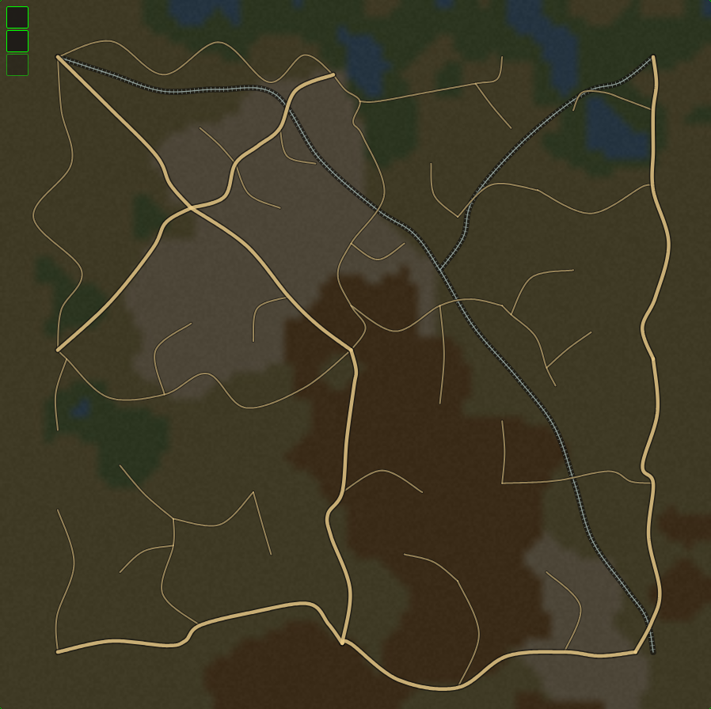
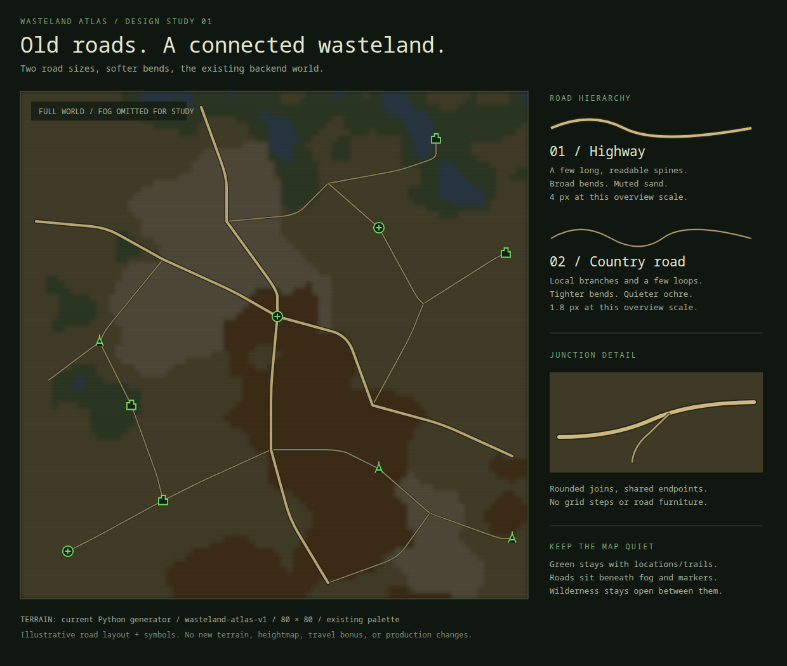

# Map roads and railroads

Public-place connections: `uv run fo-cli backfill connect-world-places` appends country
access roads from the saved coordinates of seeded public places to existing road vertices.
Each access road carries `location_id`; the existing network and terrain stay fixed.
Only places within 2 registry units of a backbone road vertex qualify, and the complete
land-safe spur must be at most 2 units long (1.6 default terrain cells). This leaves
distant places off-road and prevents long detours around water. Access roads keep normal
country-road weight. Their short geometry reuses the railway tangent simplifier for
direct driveways and restrained bends, without long-road meanders.

Private discoveries and vaults do not affect this shared layer. The pass requires the
current road recipe and is atomic and repeatable. `connect-world-places --refresh`
replaces access spurs only, removing orphaned links and reapplying the current distance
limit; ordinary runs preserve existing links. Refresh after moving/removing seeded places
or changing the access policy. Rerun after a base road-recipe upgrade. These links are
cartography, not travel bonuses.

Status: approved and implemented, 2026-11-06. The sheet below remains the illustrative
design reference. Production now renders roads from the existing backend snapshot.

Recipe v2: up to ten spaced hubs, four country-road loops, and thirty local branches.
The default world produces 43 roads (nine highways, 34 country roads) and two railroad
lines. Roads now curve along their course, rather than only rounding grid corners.
Existing worlds use `uv run fo-cli backfill world-roads` after the schema migration;
new snapshots include roads on creation. Upgrade an existing v1 road layer with
`uv run fo-cli backfill world-roads --upgrade`. The base generator/version stays unchanged.



This overview uses the production renderer with default backend terrain and the new
recipe, with fog disabled and markers omitted for inspection. The original concept
sheet follows for reference.



[Vector original](../design/map-roads-concept.svg).

## Direction

Extend the current backend-owned atlas with two sizes of old roads: a few broad
highways, thinner country roads, and enough empty wilderness for the map to breathe.
Keep the reference image's readable connected network; replace its staircase bends
with longer diagonal runs and rounded corners. Avoid decorative wiggles.

The sheet uses terrain reproduced by the **current Python generator**, default seed
`wasteland-atlas-v1`, generator v1, 80×80 tiles, and existing terrain colors. Base
checksum: `bb7fc58a79da88423878a35a06520e19`. It is not a read of the running database.
The road layout and small location symbols are illustrative, not generated production
roads or real registry placements. Terrain softening approximates the existing renderer.
Fog is omitted from this full-world design sheet so the network can be reviewed.

## Appearance

| Property | Highway | Country road |
|---|---|---|
| Role | Long routes between a few regional hubs | Local branches and occasional loops |
| Shape | Long straights, broad curves | Shorter straights, tighter rounded bends |
| Main stroke at an 800 px overview | 4 px | 1.8 px |
| Dark casing at that scale | 6.8 px | 3.4 px |
| Color | Muted sand, derived from `--color-terrain-road` | Dimmer ochre derived from the same token |

Widths are starting visual values, not physical lane widths. At the current 160-unit
SVG viewBox these correspond to 0.8/0.36 main strokes and 1.36/0.68 casings. Use map
units so roads scale with the existing viewport; check the narrow stroke at mobile
overview size before finalizing. No lane markings, highway shields, animated traffic,
broken-line texture, or extra road controls in the first pass.

Layer order: **existing terrain → railroads → country roads → highways → existing fog → trails → markers**.
Roads have no pointer interactions. Clip their visible area with the explored mask;
do not rely on translucent fog alone to conceal them. Keep green dashed discovery
trails visually separate from solid ochre roads. Markers remain the strongest signals.

### Renderer detail pass (2026-11-07)

A zoom-aware cartography pass now draws, from the same backend geometry: overview keeps
only highways and railroads; mid zoom adds country roads, highway centre dashes and
deterministic, very low-opacity region-name stencils; close zoom adds wear, pre-war
hole-shield route markers and railway station/water-tower markers. A faint survey
graticule (11×11 lines) sits inside the fog clip beneath the roads. Junctions merge
through the shared stroke and round joins, with no drawn rings or dots. No new recipe fields and no travel effects; fog clipping, exact junctions and
the backend-owned geometry contract are unchanged.

**Compositing rule:** road paint is one isolated opacity group with fully opaque strokes.
SVG flattens the group's children first, unions overlapping opaque strokes, then applies
the group opacity once — so shared endpoints and crossings do not stack into darker
blobs. Never add per-element alpha to road paint; wear is expressed only by the decay
overlay. Region stencils are keyed off the snapshot checksum, so the same snapshot always
produces the same names; no randomness.

Junctions share exact endpoints. Country roads meet the highway cleanly; draw highway
strokes over branch casings to avoid dark seams. A geometric crossing is an at-grade
junction in this first pass. No overpasses or bridge semantics yet. Railroads are a separate sparse trunk and
feeder, drawn with cool-stone rails and regular sleepers. Their joins stay exact;
crossing a road does not create a station or affect travel.

## Heightmap: later

**Roads do not need a heightmap first.** The current categorical terrain already tells
us where water and hills are. It can support land-safe routing and a preference for
flatter terrain without another generation system.

The existing generator creates a continuous noise field, uses it to classify terrain,
then discards it. If relief becomes useful, expose that same field in a later additive
change for subdued hill shading or contours. It is a normalized terrain field, not
physical elevation in meters. No erosion, drainage, climate simulation, or biome
reclassification is needed for this feature.

This proposes roads before the older elevation-first presentation sequence in
`PROTOTYPE_TO_PRODUCTION_PORT.md`; it does not change that document's movement rules.

## Small backend extension

Use `backend/app/services/map/world_generation.py` and the existing snapshot lifecycle
as the foundation. The frontend continues to render backend data; it generates neither
the network nor its geometry.

1. **Read the stored terrain.** Build roads against the existing terrain and fixed
   public inputs. Never use currently occupied vaults, private discoveries, or visible
   markers as network inputs. Do not move terrain, slots, homes, or registry points.
2. **Select a small set of hubs.** As a starting recipe, choose up to ten well-spaced land
   positions, preferring sizeable ruins areas. Use a deterministic spaced-land fallback
   if ruins are scarce. Keep them on the main traversable component. These are internal
   road endpoints, not new player-facing places or markers.
3. **Connect the backbone.** Use a small minimum spanning tree over hubs, then at most
   four extra connections to create useful loops. Route its edges as
   highways. No general graph framework or dependency is needed for a handful of hubs.
4. **Add local branches.** Select a bounded set of smaller ruins clusters or fixed
   public anchors and connect them to the nearest reachable network point as country
   roads. Allow up to thirty branches on this 80×80 world. Do not connect every
   vault slot or every marker. Off-road places should remain common.
5. **Route on land.** A small deterministic 8-neighbor A* pass can prefer wasteland,
   discourage hills, and forbid water and diagonal corner cutting. Reuse the current
   terrain vocabulary/cost table as the starting construction heuristic, not as a
   production ETA change. Stable tie-breaking and a separate roads seed stream are
   required. Prefer joining existing roads over duplicating a nearby parallel segment.
6. **Remove the grid appearance.** Simplify land-visible spans, displace interior control
   points into broad curves, and interpolate them while preserving junction coordinates. Validate the final geometry, including its
   casing footprint, against water; shorten rounding or retain the safe polyline if
   needed. Do not blindly apply `tracePath.ts`'s unconstrained Catmull–Rom curves:
   those can overshoot the routed corridor. Serialize the validated centerline as
   sufficiently dense points; the renderer only draws it with round joins and caps.

Endpoint counts are tuning defaults to inspect on the actual world, not a promise
that every seed produces the same network density. An unreachable optional branch is
omitted; a disconnected required backbone fails generation clearly. Water remains
water; bridges and isolated-island roads are deferred.

## Persistence without replacing the world

Important existing behavior: `_stream()` includes `generator_version` in terrain and
slot seeds. Simply incrementing that version and regenerating would change geography.
Roads should therefore have a **small independent recipe version** on the existing
snapshot, leaving the current base recipe/version intact.

Proposed addition: one nullable JSONB `roads` field on `WorldSnapshot`, exposed through
the current authenticated `/map/world` response:

```text
roads: null | {
  version: 2,
  base_checksum: "checksum of the terrain + slots this was built against",
  checksum: "hash of road version, base checksum, segments, and recipe inputs",
  segments: [
    { id: "h-0", kind: "highway", points: [[x, y], ...] },
    { id: "c-0", kind: "country", points: [[x, y], ...] },
    { id: "r-0", kind: "railroad", points: [[x, y], ...] }
  ]
}
```

Points use registry coordinates (0–100); convert once through the existing projection
helpers to SVG/wire space (0–160). Shared junctions have identical rounded coordinates.
Versioned constants define the first recipe; persist any adjustable recipe settings
if configuration is exposed later. Keep the existing base checksum semantics and use
the roads checksum for the additive layer. Validate the base checksum before rendering
or replacing a road payload. This is an explicit proposed extension to the versioning
rule in `WORLD_GENERATION_CONTRACT.md`, not a silent exception.

`null` means not generated; a populated payload with zero segments means an intentional
empty result. An idempotent explicit backfill/seed operation populates existing rows;
GET requests do not generate roads. That service owns one atomic update of the complete
road payload. Repeat runs for the same base/version are no-ops; stale base checksums
reject the write. No activation catalog, separate road tables, frontend generator, or
world reset is needed. Future creation should persist terrain, slots, and roads together.

## Integration and scope

- Extend the existing model/schema/service/CRUD boundaries, map service and map store.
  Regenerate API types after the backend change. Render a small SVG road group beside
  `AtlasTerrain` inside the current `WorldMap`; use the existing zoom, fog and selection.
- Reuse existing projection and terrain helpers. The retired frontend generator is
  reference material, not a second source of world data. No new map or parallel renderer.
- A later interactive review, if needed, belongs in a development-only route that mounts
  the same production map component. The attached files are static design documents.
- This first proposal is **background cartography**: quiet, non-selectable roads with
  no speed claims, route picker, or road-based ETA. Production travel stays as it is.
  `EXPEDITION_MAP_CONTRACT.md` DD3 requires a meaningful benefit before roads become
  prominent actionable routes. Making them affect travel needs its separate movement
  decision; do not import the old prototype's 0.7× discount as an incidental change.

## Implementation acceptance checks

- Same base snapshot + road recipe produces byte-identical road geometry/checksums;
  changing occupancy/discoveries cannot affect it.
- Existing terrain, slots, coordinates, base checksum and expedition timing remain
  identical after backfill. No generation occurs on repeat reads.
- Both sizes are distinguishable at overview and close zoom; bends lack staircase
  artifacts, markers remain legible, and every junction actually meets.
- Final geometry stays in bounds and off water, including smoothed bends and casing;
  required routes connect, optional branches cannot create unsafe fallbacks.
- Snapshot updates reject stale inputs and a late failure leaves no partial payload.
- Missing roads render the current map normally. Roads disappear under unexplored
  areas, do not capture clicks, and do not reveal private places.

Validation: deterministic generation and continuous casing clearance tests across
multiple seeds; connected junctions and water-barrier checks; SQLite persistence,
stale-base rejection and late-failure rollback; authenticated API serialization;
PostgreSQL migration/rollback and concurrent backfill; Vue projection, styling and
fog-clipping tests; browser inspection at overview, zoom and mobile widths. The local
backfill preserved a before/after digest of every stored world's terrain, slots,
generator version and base checksum.

### Railway revision (recipe v3)

Railroads now follow long straight runs with short, shallow transitions at necessary
bends. The road-style lateral wave is removed from railways. Junctions and water
clearance remain enforced; the highway/country geometry is identical to v2. Use the
same `world-roads --upgrade` command to refresh an older saved layer. The v2 overview
above is historical and still shows the earlier curving railway alignment.

### Coverage revision (recipe v4)

The default world now has 83 roads (nine highways and 74 country-road segments),
plus the same two railway alignments. Local roads extend into the outer map regions
and prioritize gaps farthest from the existing network. Apply with
`uv run fo-cli backfill world-roads --upgrade`; terrain and placements stay fixed.
