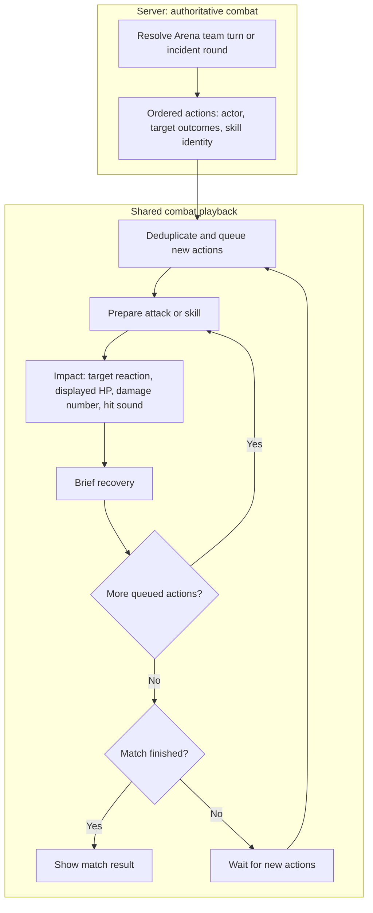

# Wasteland encounters and active combat skills

Recorded 2026-10-18 from the maintainer's three-part idea. First playable skill trial: Arena.

## Direction

1. Bring expedition site mechanics back into the exploration loop: discovering a site should give a clear
   opportunity to enter, make room choices, fight or salvage, keep loot, and retreat when needed.
2. Make more map places actionable. A location need not contain enemies: unattended supplies can simply be
   searched. Later expand existing map points by location archetype; do not turn every place into a battle.
3. Give dwellers a manual combat skill determined by their equipped weapon's **type and subtype**.
   The maintainer selected **charge earned through combat** for the first trial. Stamina remains an optional
   future alternative, with no stamina stat or economy introduced in this slice.

## Initial implementation

### Expedition sites and salvage

The existing expedition engine and entry UI remain the source of truth. Red Rocket and Super Duper Mart are
already wired through exploration details and map site markers; they were not removed. On spatial journeys,
only sites near the travelled trail are offered. No active journey means no temporary expedition markers.
That visibility rule can make the feature seem absent; this slice does not remove fog/trail requirements.

A separate salvage-sites PR proposes three level-1 sites through the same entry, resolution, loot,
outcome modal and replay guards (these catalog additions are not part of the Arena PR):

| Site | Map coordinates (catalog grid) | Contents |
| --- | --- | --- |
| Abandoned Campsite | 18, 38 | 10–25 caps and junk |
| Roadside Supply Truck | 48, 42 | 20–35 caps and junk |
| Forgotten Shack | 81, 54 | 15–30 caps and junk |

Each has one search room, no enemies, no trap, no stat roll, and a guaranteed reward on explicit resolution.
Loot joins the exploration haul; the existing return/collection flow settles it into the vault.
Spatial journeys consume an offered encounter once; legacy journeys retain the existing seven-day site cooldown.
These are authored encounter markers, not a blanket conversion of ordinary world locations into loot containers.

### Arena skill trial

- Dwellers start at zero charge. Each second of resolved combat adds 20 charge to standing dwellers, capped at
  100: three ticks on the current two-second Arena clock (six seconds of combat) fill the meter.
  Countdown, idle rooms and knocked-out fighters add none.
- The player can activate either dweller side in Duel/Brawl; Hunt exposes skills only for real dwellers.
  Training bots and creatures have no manual skill.
- Team A support bots, including the previously allowed Hunt companion, are intentionally disabled
  for this prototype at the maintainer’s request. Team A uses real dwellers; Brawl still permits a Team B bot.
- Activation reserves all 100 charge immediately, preventing double-clicks/replays. The attack resolves on the
  fighter's next team turn. Charge earned during that tick starts the next meter.
- Ordinary attacks deal 10% of each fighter's power per second, capped at 5% of the target's maximum HP per second. Each fighter pairs with a separate standing enemy in team-slot order while enough enemies remain. Survivors share the last enemy when outnumbering it. No ordinary attack spills into another fighter's target.
- Single-target skills follow the fighter's chosen target; area attacks hit every standing enemy. A skill is an extra attack before the ordinary hit and scales both normal attack damage and its cap. Only the active team attacks on a tick; Team A starts and Team B goes next. Queued skills fire only on their
  owner's team turn. A knocked-out defender cannot retaliate.
- Charge and pending attacks persist in Arena state under the same room row lock as selection/start/ticks.
  Match reset, interrupted selection and completion clear them. API ownership and participant checks apply.
- The UI keeps the charge meter and skill button inside each fighter card; descriptions are available on hover or focus. Bench and journal are collapsed by default, and setup selectors hide during a live fight. Countdown, ready, impact and finish sounds use the existing audio manager. Hit reactions, queued-skill glow and a skill-burst banner respect reduced motion. Attacks appear in
  the battle journal. Existing nonlethal knockouts, XP, happiness and result banners settle in the normal round.

| Weapon | Skill | Bonus damage (normal attack also occurs) |
| --- | --- | --- |
| Unarmed | Haymaker | 1.5× normal attack, single target |
| Melee / blunt | Crushing Blow | 1.75×, single target |
| Melee / edged | Cleave | 0.9× per enemy |
| Melee / pointed | Piercing Strike | 2×, single target |
| Gun / pistol | Quick Draw | 1.5×, single target |
| Gun / rifle | Aimed Shot | 2×, single target |
| Gun / shotgun | Scattershot | 0.9× per enemy |
| Energy / pistol | Overcharge | 1.75×, single target |
| Energy / rifle | Beam Sweep | 1× per enemy |
| Heavy / automatic | Full Auto | 1.75×, single target |
| Heavy / flamer | Firestorm | 0.9× per enemy |
| Heavy / explosive | Blast Wave | 1× per enemy |

These are prototype balance values. Effects use normal Arena attack damage so equipment and existing combat modifiers
stay relevant. No skill effects have been enabled in incidents, quests or expedition combat.

## Next passes

- Playtest expedition discovery from a fresh spatial journey and improve encounter visibility if players miss
  the entry opportunity. Preserve reconnect, retreat, supply use and reward surfacing.
- Give existing world-location archetypes explicit search/fight/choice actions through their current dispatch
  and settlement services, with discovery requirements and replay protection. Do not pay loot from client state.
- Playtest short and long Arena matches, both team sizes, Hunt and skills queued on both teams. Check whether
  current charge timing leaves enough opportunities to use a skill before a knockout; tune charge and damage together.
- Decide whether later effects need player-selected targets, stun/bleed/defence or enemy AI skill usage.
  Add those only after the damage-only trial is useful. Decide how asynchronous expedition combat will expose
  player timing before extending skills beyond Arena.

## Shared combat playback (2026-10-25)

The proposed next pass is the [weapon/race animation matrix](../frontend/COMBAT_ANIMATION_MATRIX.md),
audited against the item catalog and linked to [#1140](https://github.com/ElderEvil/falloutProject/issues/1140).
Power armor is the only outfit-related animation modifier in that design.

Skill icons use twelve local SVG glyphs, selected by the weapon-skill metadata's stable `icon` key.
The charge meter, setup/live preview, activation marker, tooltip, skill banner and battle journal share the
same component. New resolved skill actions retain their icon in event JSON; per-target area-skill journal
rows reuse that action's icon. Historical rows without icon metadata keep the generic skill marker.
Glyph provenance and the CC0 dedication for the new SVG paths are recorded in the animation matrix.

Arena and incident fights share a local playback queue. Authoritative team turns stay unchanged; Arena
presents a fighter's queued skill, then ordinary attack, then the next fighter. Incidents sequence ordinary
attacks only, using their existing server-side damage attribution and grouped threat representation.

Use one small playback queue per visible fight. Arena supplies its participants and scene; reusable attack,
projectile, impact and area effects share the same playback timing. An area skill is one action with several
target outcomes, so affected targets react together. Displayed HP changes at impact; the server snapshot
remains authoritative, and skill requests are sent immediately with queued confirmation.

On entry, reconnect after missing history, or a long absence, synchronize to the current snapshot. Ignore
duplicate actions and clear pending playback on match reset or navigation. Reduced motion preserves action
order and readable outcomes through static feedback. The final result follows the final impact and recovery.

Initial timing candidates are about 350 ms per ordinary attack and 550 ms per skill: two fighters each using
a skill and an ordinary attack would take about 1.8 seconds against the configured two-second team tick.
Large batches play up to three times faster; a queue more than six seconds behind, missing journal history,
or an absence over ten seconds synchronizes directly to the current state. Incident polling uses the existing
store subscription with a maximum two-second interval. Final incident journals arrive through the existing
aftermath refresh, keeping the visible scene mounted until its last action recovers.
Accelerated playback uses stationary attacker cues so an unfinished lunge cannot lag behind an impact.

`CombatAction` carries an actor, visual effect, optional skill name and target outcomes (damage plus optional
HP before/after). The event ID and chronological journal order identify each action. Arena stores one nullable
JSONB payload on the first journal row for an action; area skills retain their per-target log lines but animate
once. Incidents reuse their event JSON and expose the same typed action contract. A grouped threat has no
invented individual HP. Old journal rows have no action data and remain readable without historical replay.

Migration `c7e9a1b3d5f8` adds Arena action data; apply it before updating the backend and Arena worker. The
shared controller, visual effects and damage labels live in `frontend/src/modules/combat/`; each scene keeps
its own layout, while stores remain the sole owners of authoritative state and polling.

### Reusable game development findings

These principles combine the research below with issues found while implementing Arena and incident playback.
Apply them when extending combat presentation to another game mode.

- **Separate simulation time from presentation time.** Server ticks decide outcomes; a small local queue
  controls when the player sees them. Animation completion must never grant rewards, advance a turn or
  determine whether a skill request is valid. Keep requests responsive while playback is running.
- **Make impact the shared synchronization point.** Anticipation leads into one moment where target
  reaction, displayed HP, damage number and hit sound agree, followed by recovery. Define that timing in
  the playback controller; independent polling callbacks and animation timers caused the original mismatch.
- **Record facts when the action resolves.** Stable actor/target IDs, action identity/order and explicit HP
  outcomes survive delayed playback and target changes. Names are not unique, prose is not a machine
  contract, and a snapshot HP difference cannot identify which of several attacks caused the damage.
- **Share the smallest useful presentation layer.** Reuse action types, sequencing, effects and damage labels;
  let each scene own its layout and each combat service own its rules. Incident threat groups do not imply
  individual enemies or individual HP. One area action can affect several targets together while retaining
  separate journal lines; an Arena skill still precedes its owner's ordinary attack.
- **Spend visual emphasis according to gameplay importance.** Ordinary attacks should be quick and readable;
  skills deserve stronger anticipation and distinct shapes/effects. Keep the acting participant and affected
  targets identifiable, limit overlapping decoration, and preserve the outcome without sound or motion.
- **Budget for the busiest valid turn.** Include skills, ordinary attacks and all participants when comparing
  playback duration with the update cadence. Timing values need playtesting. Bound accumulated delay and
  use simpler cues during catch-up so movement cannot finish after its associated impact.
- **Treat network and scene lifecycle as part of animation design.** Deduplicate events, synchronize on
  missing history/long absences, and cancel pending effects when the fight or view changes. A delayed
  response from an old vault/account must not restore its fight. Keep one owner for polling and sound
  delivery so another consumer cannot replay them.
- **Reconcile independent snapshots explicitly.** Incident rosters can lag behind the journal; an old HP
  snapshot must not undo a played hit. A newly opened scene should show current HP, including healing,
  rather than apply historical damage again. Responders can also return to their rooms before the final
  journal arrives, so retain the presentation data needed to show their final actions.
- **Let the last hit finish.** The server may settle rewards before the client finishes playback. Keep the
  visible scene through the final impact and recovery, then show its result. Preserve the existing immediate
  progression toast/modal and notification delivery; presentation delay does not delay settlement.

For future changes, verify ordinary attacks, skill followed by normal attack, area hits, lethal hits and
retargeting; repeated/overlapping polls and rolling event windows; entry after healing, stale roster HP and
returning responders; reset/navigation/account switches and hidden tabs; final-result ordering; phone and
desktop layouts; and reduced motion. Use controlled clocks for ordering tests and real browser checks for
CSS timing, visibility and layout. Backend action records must roll back with the damage they describe.

Research references (the implementation-specific lifecycle findings above come from this project):
[scoped event queues](https://gameprogrammingpatterns.com/event-queue.html),
[Wesnoth's shared impact timing](https://wiki.wesnoth.org/AnimationWML#Timing,_Clock,_Multiple_animations),
and [Riot's visual clarity and effect hierarchy](https://www.leagueoflegends.com/en-us/news/dev/clarity-in-league/).

## Local trial

Apply the new Arena migration through the usual backend startup/migration flow. Assign adults to Arena,
select Duel/Brawl/Hunt and start. Let the meter fill during combat; activate a skill and observe the
next tick and journal. Reset the selection to clear the meters. Equip different weapon types/subtypes before
starting another match to compare their skills.

For salvage, send a level-1-or-higher explorer whose trail passes near a new site, then open its expedition
site picker or map marker. Search once, verify the outcome and retained haul, then verify repeat entry is blocked.
The existing `fo-cli expedition-scenario` helper can provision a legacy QA journey to expose the full site catalog.

## Playtest iteration (2026-10-18)

The maintainer reported overloaded UI and knockouts before a skill could charge. Ordinary Arena damage is now
halved, with a training damage cap, and charge fills after three two-second ticks (six seconds of simulated
combat). Automated tests were deferred during hands-on iteration; the final behavior now has updated
service, component and browser coverage.

### Alternating team turns (2026-10-18)

Each two-second Arena tick is one team turn: A, B, A, B. The next team is persisted, so reloads/restarts
preserve turn order. Resetting a match starts with A. Skills can be queued on either turn but resolve only
when their owner attacks; defenders keep their pending skills. Both teams still build charge while standing,
so the fast six-second opening meter is preserved. The UI highlights the next team and gives the attacking
team a brief lunge; the journal records each turn. Playtest this rhythm before adding stat-based timing.

### Individual targeting, moderated skills and journal feedback (2026-10-18)

The maintainer found shared focus fire awkward and skills too powerful. Each fighter now resolves its own
attack against a different standing enemy where possible; single-target skills use the same pairing. Skills
add an extra attack, with the normal training cap scaled by the skill multiplier. Targets are reselected
from the living team after a knockout, and excess ordinary damage does not spill into another target.

Journal entries expose the existing database creation timestamp as UTC, and display local 24-hour `hh:mm:ss`
in chronological order. Timestamped actions stay separate, including identical hits. Skill rows use an amber
highlight and lightning icon; turn, reward and finish rows have distinct tones. The match-end cue uses the
four-second quest-completion fanfare from the local sound library; the other Arena cues are unchanged.

The maintainer clarified that skill use must preserve the normal attack. Skills remain additional attacks;
the reduced damage multipliers and proportional caps provide the balance adjustment.

### Unified combatant cards and Team A composition (2026-10-18)

Dwellers, creatures and training bots use one compact setup card frame with portrait/name/stat areas
and numeric HP. Opposing slots align by shared grid rows; active skill controls live in the ring preview.
Team A now accepts only real dwellers; Brawl can retain a training-bot partner on Team B. Hunt's Team A
has one or two dwellers. Existing Team A bots are ignored; incomplete legacy Brawls stop for reselection.

The latest inspected Hunt lasted about 31 seconds. Its log confirms split targeting, alternating teams and
skills followed by normal attacks. Two balance/pacing observations are deferred for the next decision:
Cleave can round to zero damage at low power, and real turn intervals were roughly 2.5–3.8 seconds despite
the configured two-second delay. No skill damage floor or clock policy was changed in this UI/composition pass.

### Arena overview combat prototype

Selected teams now stand opposite each other over the Arena room artwork. Thin HP meters sit over every
fighter; dwellers also have an amber skill meter that can be clicked when ready. Queued skills, KOs,
damage numbers and alternating attack movement remain visible in the scene. Live matches hide the
setup cards; roster management stays available in a disclosure outside combat. Team A accepts only
dwellers; Team B can still use a training bot partner in Brawl. This frontend pass needs no migration
or worker rebuild. Automated coverage now checks pairing, charge/queue behavior, countdown placement,
model scaling, reduced motion and the responsive roster flow.

The ring staggers each side's actors between front and rear positions, with rear actors slightly
smaller. HP meters carry heart icons. When a standing dweller's skill is ready, a theme-colored crosshair
appears on their current target (using the same standing-slot pairing as combat); clicking it queues
that dweller's skill. Skill icons and custom skill tooltips use the active theme color. Queued/pending skills
and KOs do not show an activation marker. Charge-bar activation remains available as well.

Creature artwork metadata in `frontend/src/core/utils/creatureAssets.ts` owns `modelScale`, relative
to a dweller at 1×. Arena models use responsive size presets: Deathclaw/Yao Guai 1.5×, larger wildlife
1.3×, Radroach/Bloatfly 0.5× and Mole Rat/Eyebot 0.7×. Creature body frames grow or shrink while
health bars and skill activation markers retain their readable size. Rear-position perspective
still applies independently. These are visual values only; combat stats and DB schema are unchanged.

Setup roster cards are compact selection controls: 80px square portrait (112px on wider screens), name, level/power, numeric
HP and swap/remove actions. HP/charge meters, skill activation and damage feedback live exclusively
in the ring preview. Roster cards have no reserved minimum height; actions sit to the right at portrait height, and the two-team picker uses the full available width.
Names use 14–16px type and stats use 12px. On narrow screens, text occupies a full-width row beneath
the portrait/controls; wider cards place stats between the portrait and controls. This removes duplicated
combat UI from the setup area.

### Weapon and body presentation (2026-10-25)

Arena and incident actions now snapshot weapon delivery and attacker/target body profiles in their existing
JSON payload. Shared `CombatantMotion` applies melee follow-through, ranged recoil and weighted race/power
armor reactions while keeping controls and meters fixed. No combat formulas, turn order or action timing
change. Historical actions fall back to human motion; reduced motion and catch-up suppress body travel.
See the [animation matrix](../frontend/COMBAT_ANIMATION_MATRIX.md) for implemented profiles and remaining
family/artwork refinements.
